# Tugas Week 9 & 10 - ExpressJS + PostgreSQL + Prisma

**Nama:** Keisya Halimah Mulia  
**NRP:** 5027251068  
**Kelas:** Pemrograman Web C

---

## Deskripsi Tugas

Pull Request ini mengintegrasikan materi **Week 9** (REST API Express dasar dengan arsitektur Route & Controller dan in-memory array) dan **Week 10** (Migrasi penyimpanan data ke **PostgreSQL** menggunakan **Prisma ORM**, dilengkapi validasi input dan error handling middleware).

---

## Struktur Project

```
├── app.js                        ← Express server entrypoint
├── controllers/
│   ├── productController.js      ← Week 9: handler GET & POST (array)
│   ├── productGetController.js   ← Week 10: GET dengan Prisma
│   ├── productPostController.js  ← Week 10: POST dengan Prisma
│   ├── productPutController.js   ← Week 10: PUT dengan Prisma
│   └── productDeleteController.js← Week 10: DELETE dengan Prisma
├── data/
│   └── products.js               ← Week 9: array in-memory
├── lib/
│   └── prisma.js                 ← Prisma Client singleton
├── middlewares/
│   ├── requestLogger.js          ← Logging setiap HTTP request
│   ├── validateProduct.js        ← Validasi field name & price
│   ├── validateId.js             ← Validasi parameter ID
│   ├── errorHandler.js           ← Error handling terpusat
│   └── notFoundHandler.js        ← Handler 404 route tidak ada
├── prisma/
│   ├── schema.prisma             ← Model Product & konfigurasi DB
│   ├── seed.js                   ← Data awal Week 9
│   └── migrations/               ← Riwayat perubahan tabel
├── routes/
│   ├── productRoutes.js          ← Router utama
│   ├── productGetRoutes.js
│   ├── productPostRoutes.js
│   ├── productPutRoutes.js
│   └── productDeleteRoutes.js
├── docs/evidence/                ← Screenshot bukti pengujian
└── postman/                      ← Koleksi Postman
```

---

## Daftar Endpoint

| Method | Endpoint | Status Sukses | Keterangan |
|--------|----------|--------------|------------|
| GET | `/products` | 200 | Seluruh produk |
| GET | `/products/:id` | 200 | Satu produk; 404 jika tidak ada |
| POST | `/products` | 201 | Membuat produk baru |
| PUT | `/products/:id` | 200 | Update produk; 404 jika tidak ada |
| DELETE | `/products/:id` | 204 | Hapus produk; 404 jika tidak ada |

---

## Laporan Evidence Pengujian

### 1. GET /products — Menampilkan Seluruh Data (200 OK)

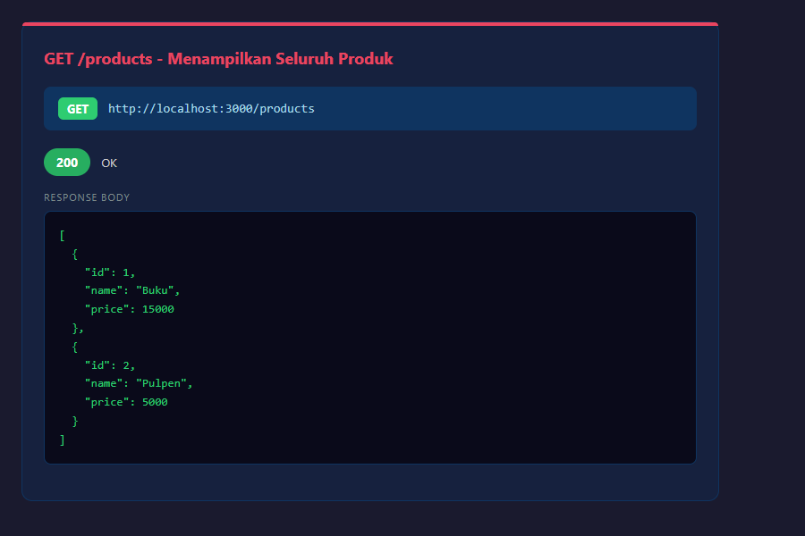

---

### 2. GET /products/1 — Menampilkan Produk Berdasarkan ID (200 OK)

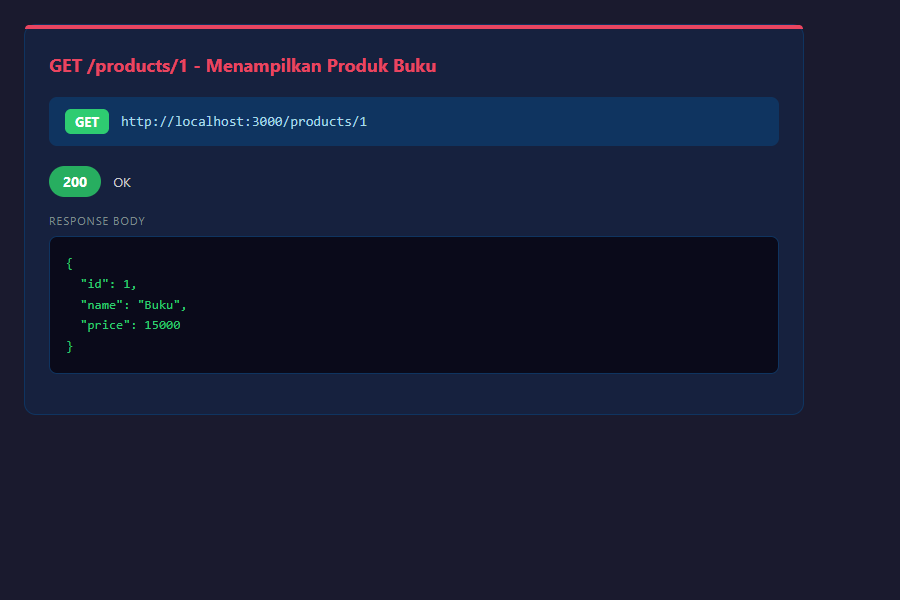

---

### 3. GET /products/999 — Produk Tidak Ditemukan (404 Not Found)

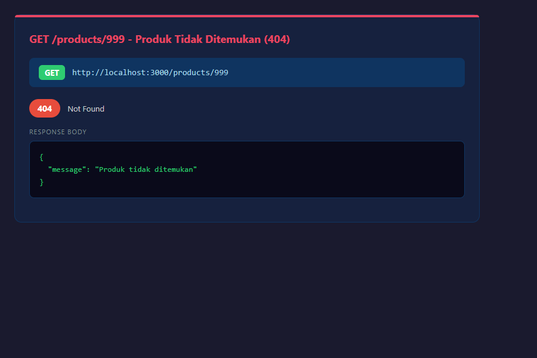

---

### 4. GET /products/abc — ID Tidak Valid (400 Bad Request)

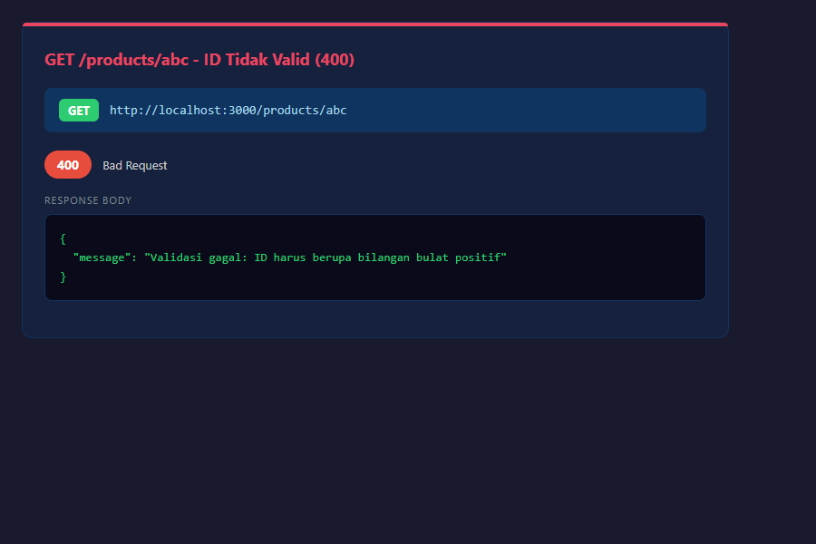

---

### 5. POST /products — Validasi Gagal: Name Kosong (400 Bad Request)

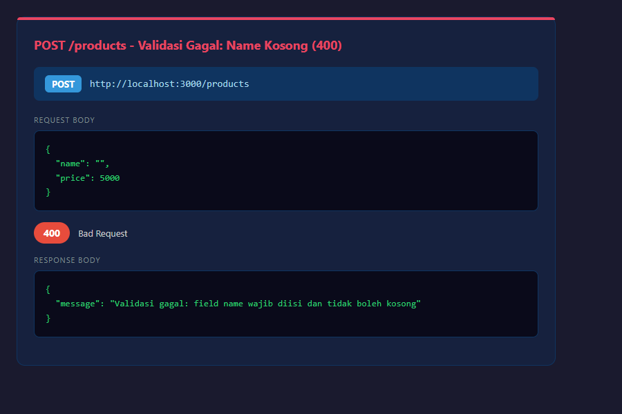

---

### 6. POST /products — Validasi Gagal: Price Negatif (400 Bad Request)

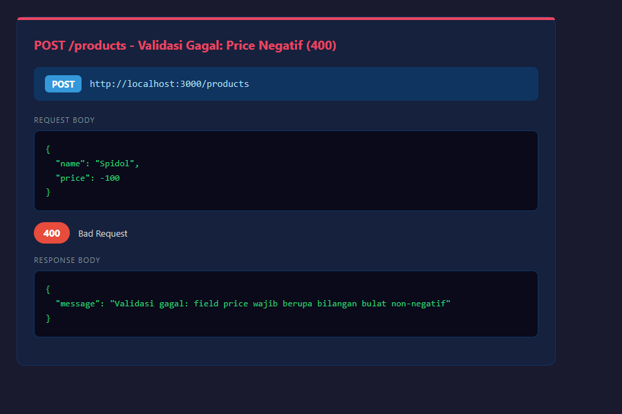

---

### 7. Database BEFORE POST — Kondisi Awal Data Week 9

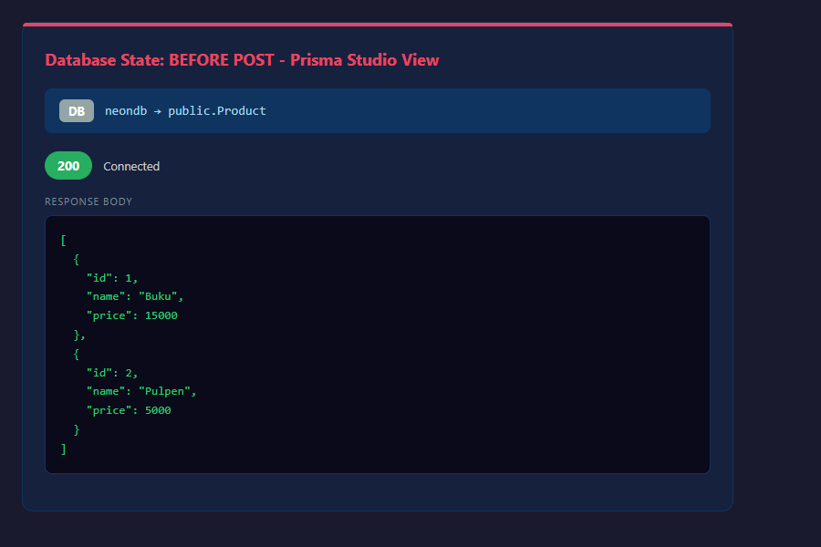

---

### 8. POST /products — Membuat Produk Baru (201 Created)

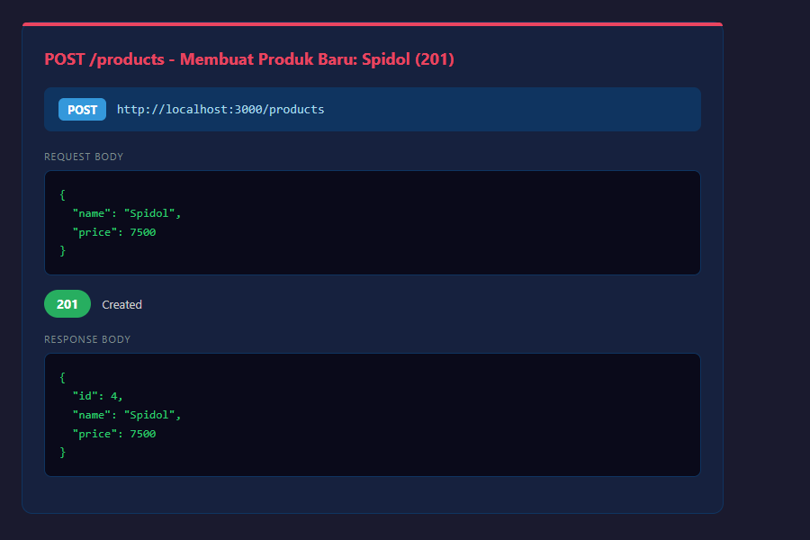

---

### 9. Database AFTER POST — Produk Baru Tersimpan

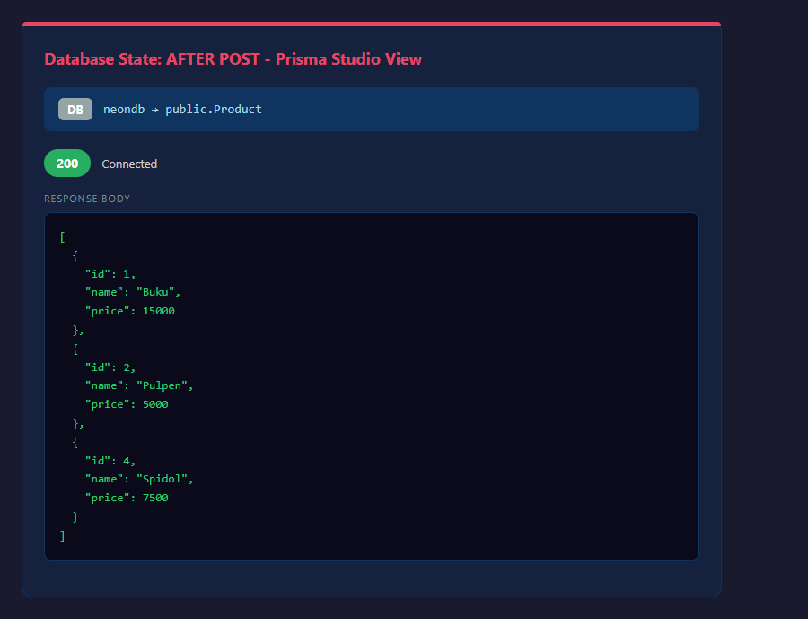

---

### 10. PUT /products/:id — Update Produk (200 OK)

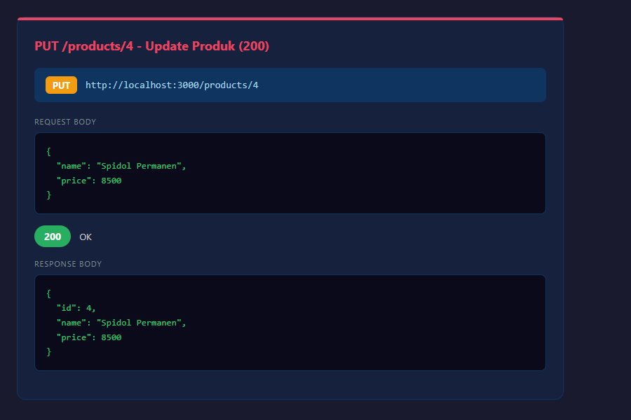

---

### 11. Database AFTER PUT — Data Produk Terupdate

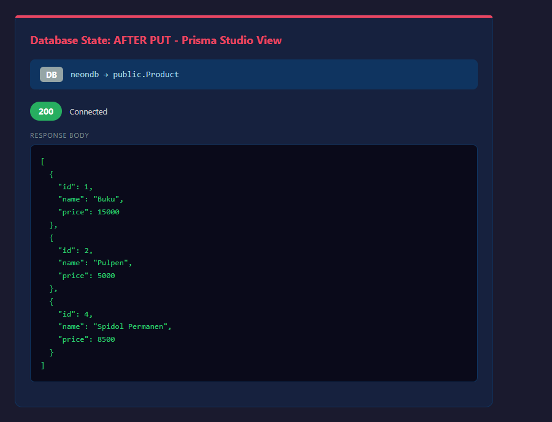

---

### 12. DELETE /products/:id — Hapus Produk (204 No Content)

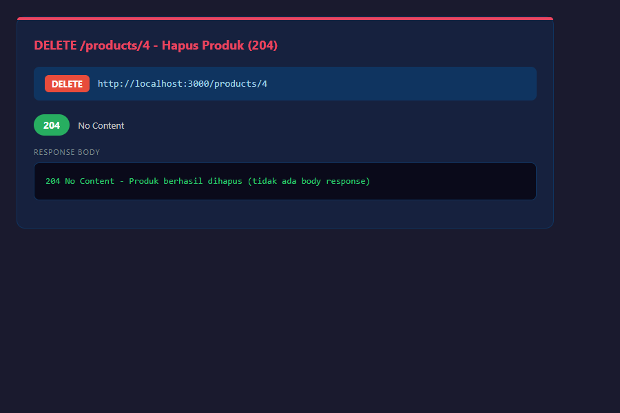

---

### 13. DELETE /products/999 — Produk Tidak Ada (404 Not Found)

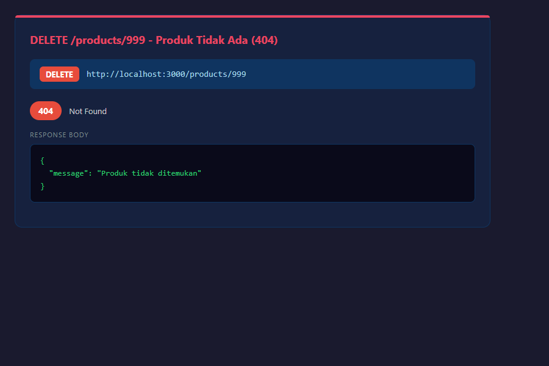

---

### 14. Database AFTER DELETE — Produk Terhapus, Data Kembali ke Awal

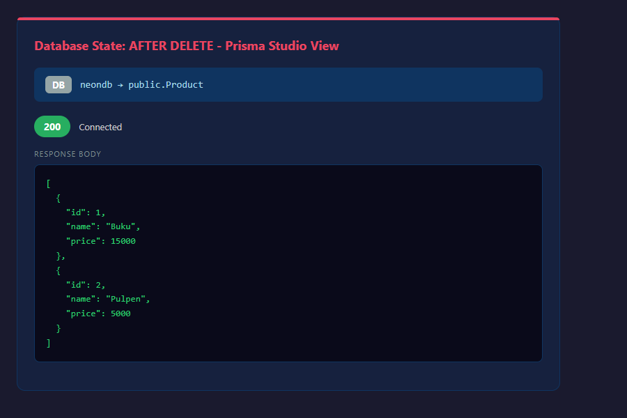

---

## Cara Menjalankan

```bash
# Install dependencies
npm install

# Generate Prisma Client
npx prisma generate

# Deploy migrasi (atau gunakan migrate dev untuk development)
npx prisma migrate deploy

# Seed data awal (Buku & Pulpen)
node prisma/seed.js

# Jalankan server
npm start
```

Server berjalan di `http://localhost:3000`.

---

## Catatan Penting

- Data awal Week 9 (Buku Rp 15.000, Pulpen Rp 5.000) tersimpan permanen di PostgreSQL.
- Restart server **tidak** menghapus data — ini membuktikan migrasi dari volatile array ke persistent database berhasil.
- File `.env` **tidak** di-commit ke repository (berisi credential database).
