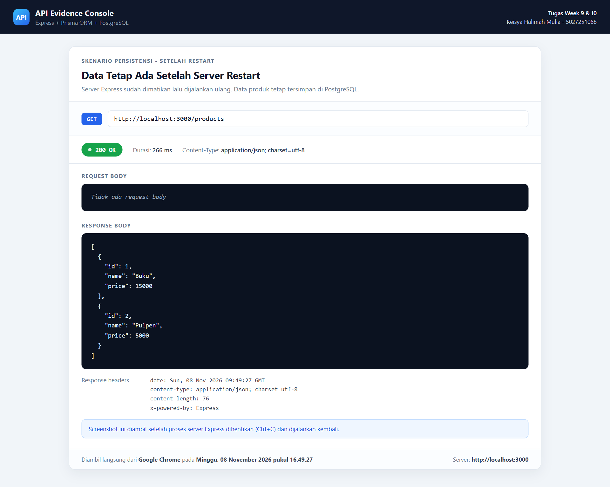

# Tugas Week 9 & 10: ExpressJS + PostgreSQL + Prisma

**Nama:** Keisya Halimah Mulia  
**NRP:** 5027251068  
**Kelas:** Pemrograman Web C

---

## Penting: Ini Tugas Backend, Bukan Frontend

Project ini **100% REST API (backend)**. Tidak ada halaman HTML/CSS/React dan
tidak ada UI yang dibuat sendiri.

- Server dijalankan lewat terminal (`npm start` atau `npm run dev`).
- Request diuji lewat **Postman** atau **Hoppscotch** (API client asli).
- Isi database dilihat lewat **Prisma Studio**.
- **Tidak perlu** membuka Inspect Element atau Console browser.

Seluruh screenshot di `docs/evidence/` diambil langsung dari aplikasi asli:
**Hoppscotch** untuk request/response API dan **Prisma Studio** untuk isi tabel
`Product`. Tidak ada halaman web tiruan atau gambar hasil rekayasa.

---

## Deskripsi Tugas

Project ini menggabungkan materi **Week 9** dan **Week 10**:

- **Week 9:** REST API Express dasar dengan arsitektur Route & Controller,
  data disimpan di array in-memory (`data/products.js`).
- **Week 10:** Data dipindahkan ke **PostgreSQL** menggunakan **Prisma ORM**,
  ditambah validasi input, error handling middleware, dan operasi CRUD lengkap.

---

## Struktur Project

```
├── app.js                         <- Entry point Express
├── controllers/
│   ├── productController.js       <- Week 9: GET & POST (array)
│   ├── productGetController.js    <- Week 10: GET (Prisma)
│   ├── productPostController.js   <- Week 10: POST (Prisma)
│   ├── productPutController.js    <- Week 10: PUT (Prisma)
│   └── productDeleteController.js <- Week 10: DELETE (Prisma)
├── data/
│   └── products.js                <- Week 9: array in-memory
├── lib/
│   └── prisma.js                  <- Prisma Client singleton
├── middlewares/
│   ├── requestLogger.js           <- Log setiap request
│   ├── validateProduct.js         <- Validasi name & price
│   ├── validateId.js              <- Validasi parameter ID
│   ├── errorHandler.js            <- Error handling terpusat
│   └── notFoundHandler.js         <- 404 untuk route yang tidak ada
├── prisma/
│   ├── schema.prisma              <- Model Product & konfigurasi database
│   ├── seed.js                    <- Data awal (Buku & Pulpen)
│   └── migrations/                <- Riwayat migrasi tabel
├── routes/
│   ├── productRoutes.js           <- Router utama
│   ├── productGetRoutes.js
│   ├── productPostRoutes.js
│   ├── productPutRoutes.js
│   └── productDeleteRoutes.js
├── postman/
│   ├── Keisya-Week10.postman_collection.json
│   └── Keisya-Week10.postman_environment.json
└── docs/
    └── evidence/                  <- Tempat screenshot asli milikmu
```

---

## Daftar Endpoint

| Method | Endpoint        | Status Sukses | Keterangan                              |
| ------ | --------------- | ------------- | --------------------------------------- |
| GET    | `/products`     | 200           | Seluruh produk                          |
| GET    | `/products/:id` | 200           | Satu produk; 404 jika tidak ada         |
| POST   | `/products`     | 201           | Membuat produk baru                     |
| PUT    | `/products/:id` | 200           | Update produk; 404 jika tidak ada       |
| DELETE | `/products/:id` | 204           | Hapus produk; 404 jika tidak ada        |

Aturan validasi:

- `name` wajib string dan tidak boleh kosong.
- `price` wajib bilangan bulat dan tidak boleh negatif.
- `:id` wajib bilangan bulat positif, jika tidak maka `400 Bad Request`.

---

## Cara Menjalankan

```bash
# 1. Install dependencies
npm install

# 2. Salin file environment lalu isi DATABASE_URL dan DIRECT_URL
#    (contoh tersedia di .env.example)

# 3. Generate Prisma Client
npx prisma generate

# 4. Terapkan migrasi ke database
npx prisma migrate deploy

# 5. Isi data awal: Buku Rp 15.000 dan Pulpen Rp 5.000
npm run prisma:seed

# 6. Jalankan server
npm start        # atau: npm run dev
```

Shortcut untuk langkah 3 sampai 5 (generate + migrasi + seed):

```bash
npm run db:setup
```

Server berjalan di `http://localhost:3000`.

Untuk melihat isi database:

```bash
npx prisma studio
```

---

## Cara Menguji di Postman / Hoppscotch

### Postman

1. Pastikan server sudah berjalan (`npm start`).
2. Buka aplikasi **Postman**.
3. Klik **Import** lalu pilih
   `postman/Keisya-Week10.postman_collection.json`.
   (Opsional) import juga `postman/Keisya-Week10.postman_environment.json`
   lalu pilih environment **Keisya Week 10 - Local**.
4. Buka collection **Keisya Week 10 - Product API**.
5. Pastikan collection variable `baseUrl` berisi `http://localhost:3000`.
6. Klik salah satu request, lalu klik **Send**.
7. Di bagian bawah akan muncul:
   - **Status** (contoh: `200 OK`, `201 Created`, `404 Not Found`),
   - tab **Body** dengan pilihan **Pretty** dan **JSON**.
8. Screenshot bagian URL + method, tab Body, dan Status tersebut.

Catatan:

- Request **08 - POST buat produk** otomatis menyimpan ID produk baru ke
  variable `createdProductId`. Jadi request PUT, GET, dan DELETE sesudahnya
  memakai ID produk yang baru dibuat, bukan ID produk seed.
- Request **02 - GET produk by ID** memakai variable `productId` (default `1`),
  jadi produk seed tidak ikut berubah saat collection dijalankan.
- Jika collection dijalankan berurutan (Collection Runner), semua request
  berjalan tanpa perlu mengganti ID manual.
- Screenshot **harus** diambil dari Postman/Bruno/Hoppscotch asli, bukan dari
  halaman web tiruan.

### Hoppscotch

1. Buka `https://hoppscotch.io`.
2. Pilih method (GET, POST, PUT, atau DELETE) lalu isi URL, contoh
   `http://localhost:3000/products`.
3. Untuk POST dan PUT, buka tab **Body**, pilih content type
   `application/json`, lalu isi body JSON.
4. Klik **Send**.
5. Status dan **Response Body** akan muncul di panel bawah. Screenshot bagian
   method, URL, status, dan response tersebut.

Screenshot pada folder `docs/evidence/` diambil dengan cara ini, sehingga yang
terlihat adalah request dan response asli dari server Express.

---

## Checklist Evidence yang Perlu Di-screenshot

Simpan hasil screenshot asli ke folder `docs/evidence/` dengan nama berikut.
Semua file pada tabel di bawah sudah tersedia dan diambil dari aplikasi asli
(Hoppscotch dan Prisma Studio).

| No | Aksi | Status yang Diharapkan | Nama File |
| -- | ---- | ---------------------- | --------- |
| 01 | GET `/products` | 200 OK | `01-get-all-products.png` |
| 02 | GET `/products/1` | 200 OK | `02-get-product-by-id.png` |
| 03 | GET `/products/999` | 404 Not Found | `03-get-product-not-found.png` |
| 04 | GET `/products/abc` | 400 Bad Request | `04-get-invalid-id.png` |
| 05 | POST dengan `name` kosong | 400 Bad Request | `05-post-validation-fail-name.png` |
| 06 | POST dengan `price` negatif | 400 Bad Request | `06-post-validation-fail-price.png` |
| 07 | Prisma Studio sebelum POST | 2 data (Buku, Pulpen) | `07-db-before-post.png` |
| 08 | POST `{"name":"Spidol","price":7500}` | 201 Created | `08-post-success.png` |
| 09 | Prisma Studio setelah POST | 3 data | `09-db-after-post.png` |
| 10 | PUT `/products/:id` | 200 OK | `10-put-success.png` |
| 11 | Prisma Studio setelah PUT | Data berubah | `11-db-after-put.png` |
| 12 | DELETE `/products/:id` | 204 No Content | `12-delete-success.png` |
| 13 | DELETE `/products/999` | 404 Not Found | `13-delete-not-found.png` |
| 14 | Prisma Studio setelah DELETE | Kembali 2 data | `14-db-after-delete.png` |
| 15 | Hentikan server (Ctrl+C), jalankan lagi, lalu GET `/products` | 200 OK, data tetap ada | `15-data-persists-after-restart.png` |

Langkah screenshot Prisma Studio: jalankan `npx prisma studio`, buka tab yang
terbuka otomatis, lalu screenshot tabel `Product` beserta jumlah record-nya.

### Urutan Pengujian yang Dipakai

1. Database direset ke data awal: `Buku` dan `Pulpen`.
2. Screenshot 01 sampai 06 diambil dari request yang gagal maupun berhasil.
3. Screenshot 07 diambil dari Prisma Studio sebelum ada data baru.
4. Request 08 membuat produk baru (`Spidol`) dengan status `201 Created`.
5. Screenshot 09 menunjukkan produk baru sudah masuk ke tabel.
6. Request 10 mengubah produk tersebut, lalu screenshot 11 menunjukkan
   perubahan datanya.
7. Request 12 menghapus produk tersebut, request 13 menguji ID yang tidak ada,
   dan screenshot 14 menunjukkan tabel kembali berisi 2 data.
8. Server dihentikan dengan Ctrl+C lalu dijalankan lagi dengan `npm start`.
   Request 15 membuktikan data tetap ada setelah restart.

Semua status dan isi response pada screenshot berasal dari server yang benar
benar berjalan dan terhubung ke PostgreSQL, bukan hasil edit gambar.

---

## Screenshot Evidence

### Request API (Hoppscotch)

**01. GET `/products` - 200 OK**


**02. GET `/products/1` - 200 OK**


**03. GET `/products/999` - 404 Not Found**


**04. GET `/products/abc` - 400 Bad Request**


**05. POST `name` kosong - 400 Bad Request**


**06. POST `price` negatif - 400 Bad Request**


**08. POST `Spidol` 7500 - 201 Created**


**10. PUT `/products/3` - 200 OK**


**12. DELETE `/products/3` - 204 No Content**


**13. DELETE `/products/999` - 404 Not Found**


**15. GET `/products` setelah server restart - 200 OK**



### Isi Database (Prisma Studio)

**07. Sebelum POST - 2 data**


**09. Setelah POST - 3 data**


**11. Setelah PUT - data berubah**


**14. Setelah DELETE - kembali 2 data**


---

## Hasil Verifikasi Backend (Sudah Diuji)

Pengujian berikut dilakukan langsung ke server Express yang terhubung ke
PostgreSQL (Neon), bukan simulasi:

| Skenario | Hasil |
| -------- | ----- |
| GET `/products` | `200 OK` |
| GET `/products/1` | `200 OK` |
| GET `/products/999` | `404 Not Found` |
| GET `/products/abc` | `400 Bad Request` |
| POST `name` kosong | `400 Bad Request` |
| POST `price` negatif | `400 Bad Request` |
| POST `price` desimal | `400 Bad Request` |
| POST data valid | `201 Created` |
| PUT data valid | `200 OK` |
| GET produk hasil update | `200 OK` |
| DELETE data valid | `204 No Content` |
| GET produk yang sudah dihapus | `404 Not Found` |
| DELETE ID tidak ada | `404 Not Found` |
| GET endpoint tidak ada | `404 Not Found` |

---

## Catatan Penting

- Data awal Week 9 (Buku Rp 15.000, Pulpen Rp 5.000) tersimpan permanen di
  PostgreSQL.
- Restart server tidak menghapus data. Ini membuktikan migrasi dari array
  volatile ke database persisten berhasil.
- File `.env` tidak di-commit ke repository karena berisi credential database.
- `npm run prisma:seed` akan mengosongkan tabel lalu mengisi ulang data awal.
